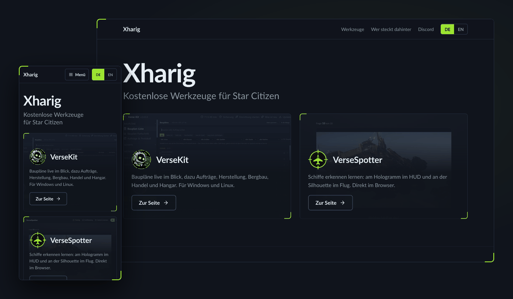

# Xharig

**Ich baue Werkzeuge für Star Citizen: fertig zum Starten, deutsch und englisch, kostenlos.**

Alles auf einen Blick: <a href="https://xharig.com/">xharig.com</a>

 

---

## Meine Werkzeuge

| | Werkzeug | Was es tut | |
|---|---|---|---|
|  | **[VerseKit](https://github.com/Xharig/VerseKit)** | Overlay für Baupläne, Aufträge, Herstellung, Bergbau und Handel. Meldet einen neuen Bauplan in der Sekunde, in der du ihn bekommst. Windows und Linux | [Webseite](https://versekit.xharig.com/) · [Herunterladen](https://xharig.com/download) |
|  | **[VerseSpotter](https://github.com/Xharig/VerseSpotter)** | Schiffe erkennen lernen: am Hologramm im HUD, am Umriss und klein am Himmel. Direkt im Browser | [Loslegen](https://versespotter.xharig.com/) |

<b>Wie ich arbeite</b>

Ich bin kein Programmierer von Beruf. Was ich baue, entsteht, weil mir im Spiel
etwas gefehlt hat, und dann soll es auch für andere funktionieren, nicht nur bei
mir. Daraus sind ein paar feste Regeln geworden:

- **Fertiges Werkzeug, kein Bausatz.** Wer es benutzt, soll eine Datei laden und
  starten. Nichts von Hand einrichten, nichts nachinstallieren.
- **Was nicht gemessen ist, wird nicht behauptet.** Zahlen in der Anleitung kommen
  aus echten Daten, nicht aus dem Gefühl.
- **Jeder, der einen Fehler meldet, wird namentlich genannt**, im Änderungsprotokoll
  und im Programm selbst. Diese Leute testen freiwillig auf ihrem eigenen Rechner.
- **Deutsch und Englisch gleichwertig.** Eine halbe Übersetzung sieht schlechter aus
  als gar keine.

## Kontakt

| | |
|---|---|
| 💬 | [Discord](https://xharig.com/discord): Fragen, Fehler, Vorschläge |
| ✉️ | [support@xharig.com](mailto:support@xharig.com) |
| ☕ | [Ko-fi](https://ko-fi.com/xharig): falls dir etwas davon Zeit gespart hat |

**Neu in Star Citizen?** Meldest du dich mit meinem Empfehlungscode [`STAR-YC7L-S4W2`](https://robertsspaceindustries.com/enlist?referral=STAR-YC7L-S4W2) an, bekommst du nach dem Kauf eines Spielpakets 50.000 UEC Startguthaben im Spiel dazu.

---

**Star Citizen Fan Content**

This is an unofficial Star Citizen fan project, not affiliated with the Cloud Imperium
group of companies. All content on this site not authored by its host or users are
property of their respective owners.

